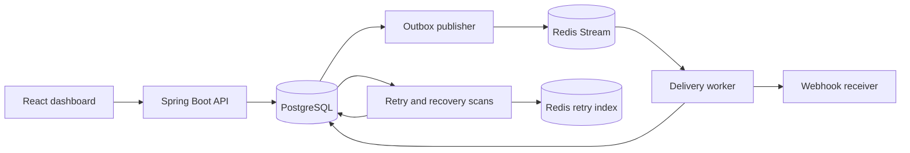

# Architecture

An event request inserts the event, matching delivery jobs, and outbox rows in one PostgreSQL transaction. The outbox publisher claims rows with `FOR UPDATE SKIP LOCKED`, publishes job IDs to the Redis Stream, then marks the rows published. A worker claims a queued job with a PostgreSQL lease, creates an attempt record in the same transaction, sends HTTP outside that transaction, and commits the result before acknowledging the Stream entry.

Transient failures store a due timestamp in PostgreSQL, then best-effort index it in a Redis sorted set. The retry scheduler reads Redis and scans PostgreSQL for due jobs, atomically queues each job and inserts a new outbox row. Recovery scans expired leases and old queued jobs. `XAUTOCLAIM` reassigns pending Stream entries after their idle threshold.

The local frontend is served by nginx on port 3000. It proxies `/api` and `/actuator` to the backend and `/demo` to the mock receiver. All published ports bind to `127.0.0.1`.

Delivery semantics are **at least once**. A receiver may process a request immediately before a worker crashes, so retries can repeat the HTTP call. Receivers can deduplicate using `X-EventFlow-Delivery-Id`.
