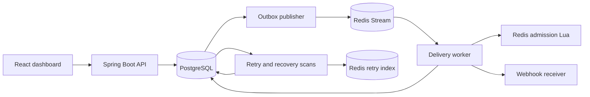

# Architecture

An event request inserts the event, matching delivery jobs, and outbox rows in one PostgreSQL transaction. The outbox publisher claims rows with `FOR UPDATE SKIP LOCKED`, publishes job IDs to the Redis Stream, then marks the rows published. A worker claims a queued job with a PostgreSQL lease, creates an attempt record in the same transaction, sends HTTP outside that transaction, and commits the result before acknowledging the Stream entry.

Transient failures store a due timestamp in PostgreSQL, then best-effort index it in a Redis sorted set. The retry scheduler reads Redis and scans PostgreSQL for due jobs, atomically queues each job and inserts a new outbox row. Recovery scans expired leases and old queued jobs. `XAUTOCLAIM` reassigns pending Stream entries after their idle threshold.

The local frontend is served by nginx on port 3000. It proxies `/api` and `/actuator` to the backend and `/demo` to the mock receiver. All published ports bind to `127.0.0.1`.

Delivery semantics are **at least once**. A receiver may process a request immediately before a worker crashes, so retries can repeat the HTTP call. Receivers can deduplicate using `X-EventFlow-Delivery-Id`.

## Distributed delivery admission

Before executor submission or PostgreSQL attempt claim, the polling thread resolves the job's endpoint and runs one Lua acquisition over `eventflow:{eventflow:admission}:global` and `eventflow:{eventflow:admission}:endpoint:<uuid>`. The shared hash tag keeps both keys in one Redis Cluster slot so global and endpoint acquisition is atomic. Each acquisition uses a unique token stored in both expiry-scored sorted sets. Renewal succeeds only while that token remains in both sets; release removes only that token and is idempotent.

The single slot is an intentional Phase 2 coordinator and a throughput ceiling that must be measured. It is selected for exact healthy-state atomicity, not presented as horizontally scalable admission. Redis server time drives expiry. Expired tokens are removed during later acquisitions, so crashes do not create permanent permit leaks.

Capacity denial and Redis admission errors release local capacity immediately and leave the Stream entry in the PEL. A PostgreSQL `capacity_deferred_until` timestamp suppresses queued-job reconciliation during that interval without changing status or consuming an attempt. `XAUTOCLAIM` retries after `PENDING_IDLE_SECONDS`, while new Stream entries for independent endpoints continue to progress. The executor never waits for distributed capacity.

In-flight HTTP work continues during a Redis outage. If renewal cannot complete before expiry, Redis may admit replacement work while the original request is still running; therefore this is lease-based bounded concurrency, not strict concurrency under arbitrary pauses, partitions, or failover state loss. PostgreSQL lease ownership still prevents stale finalization, and ACK still follows the durable PostgreSQL outcome.
